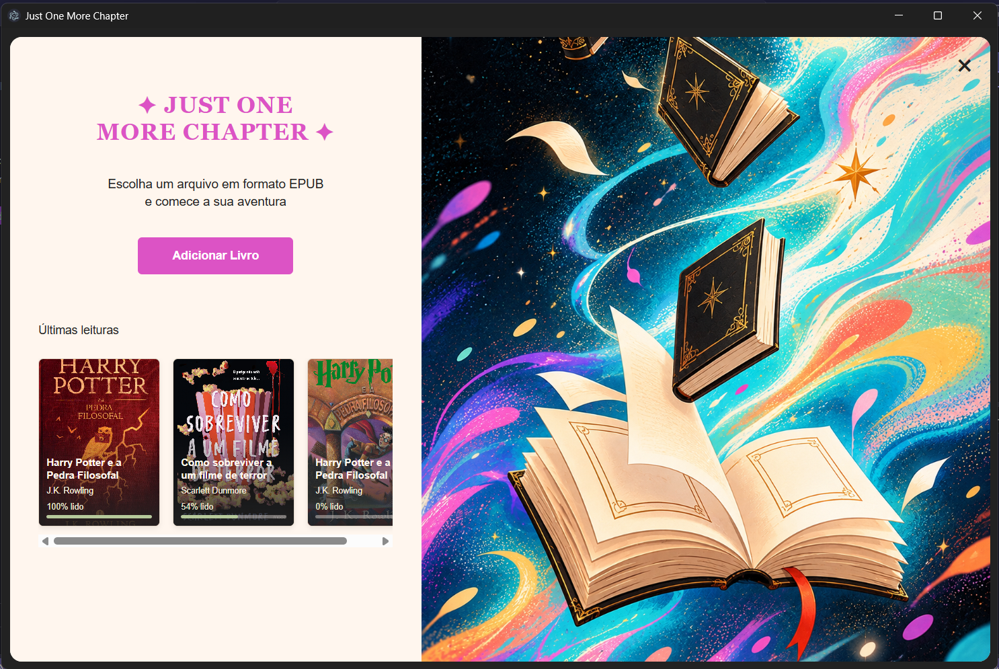
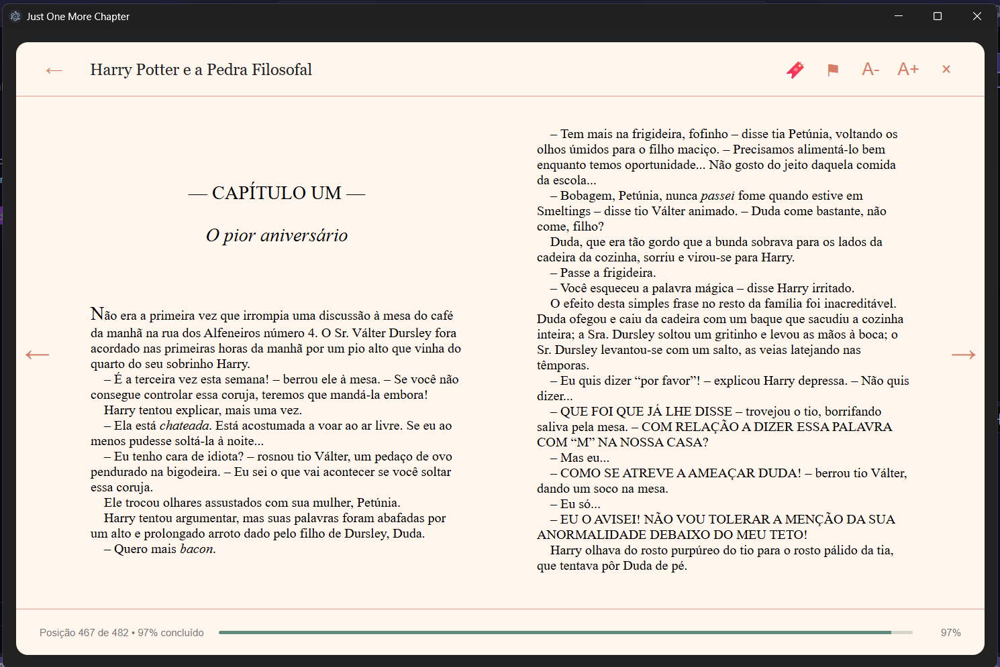

# 📖 E-reader para Desktop - Just One More Chapter

O Just One More Chapter é um app desenvolvido para quem gosta de ler livros/arquivos em formato EPUB no Desktop. A ideia surgiu de uma necessidade pessoal minha pois como leio bastante no celular e um kindle não seria uma opção viável(chorando horrores 🥲), pensei em ler no notebook. Depois de muito pesquisar não consegui encontrar um app confortável para ler livros e ✨decidi criar o meu próprio✨  

Esse projeto foi pensado por mim e fiz do protótipo no Figma até o código. A próxima etapa é resolver pequenos bugs e criar um build do projeto em formato .exe(arquivo do Windows) pois escolhi o Electron por que queria testar essa parte também. Por fim, esse projeto ainda não está disponível para usuários testarem mas está em reta final. 

## 🛠️ Tecnologias utilizadas

- **Electron.js** - utiliza HTML, CSS e JavaScript para construção de apps
- **Epub js** - biblioteca utilizada no projeto para renderizar os arquivos eBooks em formato epub no navegador

## 📌 Funcionalidades

### 📃 Páginas
- **Home** — página inicial com os últimos arquivos abertos(caso seja a primeira vez aberto não aparecerá nada) e um botão para acessar o explorador de arquivos do Windows para adicionar um arquivo `.epub` ao app
- **Arquivo Aberto** — tela com o conteúdo do arquivo aberto e barra inferior com andamento da leitura em porcentagem, e menu superior com opções de aumentar e diminuir fonte, marcar página e setas para a página anterior e página seguinte. 



### 📖 E-reader Just One Chapter

- **Adicionar Arquivo** — dentro do app é possível adicionar um arquivo em formato Epub e ler o conteúdo, podendo acompanhar o status da leitura pela barra inferior que vai indicando quanto do arquivo já foi lido.
- **Macador de Página** - nó ícone de marcador vermelhor no menu superior da tela de leitura é possível marcar a página onde a leitura foi interrompida, mas o sistema do app sempre vai abrir o arquivo na última página onde le foi fechado assim não é perdido o ponto da leitura.  
- **Marcação de Passagens do Texto** - no ícone ao lado do marcador representando por uma bandeira é possivel clicar e vai aparecer um menu lateral com um histórico de todas as páginas que já tiveram passagens do texto marcadas com a indicação da posição da leitura. Para selecionar o texto a ser destacado basta selecionar com o mouse e escolher uma das cores que vai aparecer no menu flutuante. 
- **Alteração de Tamanho da fonte** - no menu superior também tem duas opções utilizadas para aumentar ou diminuir a fonte do conteúdo relacionado ao arquivo. 

## 📑 Estrutura do projeto

```
renderer/
  index.html # arquivo principal onde a base do projeto foi feita
  main.js # inicialização do app e configuração das páginas como tamanho da jenela, etc.
  assets/
  images/
    banner.png # ilustração da página inicial
  css/
    style.css # arquivo onde a estilização das páginas do app é definida
  js/
    home.js # arquivo onde as funções de abrir um arquivo, guardar o progresso do livro, pega informações do livro como capa, titulo etc. e definição de notificações
    reader.js # arquivo onde todas as funcionalidades são definidas como criar passagens do livro, armazenar marcadores do livro, <br> renderizar os arquivos epubs, e salvamento automático da última página aberta do arquivo para abrir de onde parou quando o arquivo <br> for aberto novamente
    
```
## ⚙️ Como rodar o projeto

```bash
npm install
npm start
```